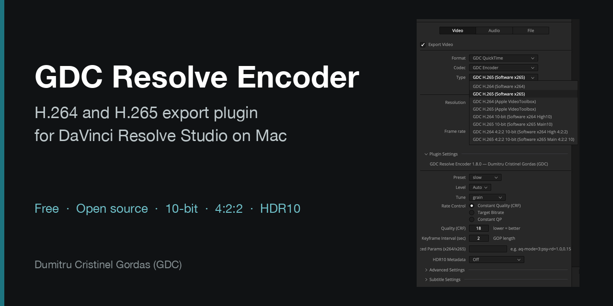

<p align="center"></p>

# GDC Resolve Encoder

[Română](README.md) · **English** · [Español](README.es.md) · [Product page](https://gordas.dev/gdc-resolve-encoder/en/)

A **free, open-source** plugin for **DaVinci Resolve Studio** on Mac: it adds complete H.264 and H.265 encoders, 10-bit, 4:2:2, HDR10 and three containers of its own (GDC QuickTime, GDC MP4, GDC Matroska) to Deliver.

No account, activation, trial period or mandatory donation: install and export.

## Download

Latest version: [Releases](https://github.com/gordasgdc/gdc-resolve-encoder/releases/latest) · macOS package `GDCResolveEncoder-<version>.pkg` (signed and notarized, Apple Silicon, macOS 26+ declared by the build, verified on macOS 27). It works only with DaVinci Resolve Studio; the free Resolve does not load export plugins.

1. Double-click the `.pkg` and follow the installer (it asks for your Mac password).
2. Restart DaVinci Resolve.
3. In **Deliver**: **Format** → GDC QuickTime / GDC MP4 / GDC Matroska, **Codec** → GDC Encoder, **Type** → the variant you want.

Full PDF guide (RO · EN · ES): [`docs/guides/`](docs/guides/).

## What it offers

| Type variant | Encoder | Depth / chroma |
|---|---|---|
| GDC H.264 / H.265 (Software) | x264 / x265 | 8-bit 4:2:0 |
| GDC H.264 / H.265 (Apple VideoToolbox) | hardware | 8-bit 4:2:0 |
| GDC H.264 / H.265 10-bit | x264 High10 / x265 Main10 | 10-bit 4:2:0 |
| GDC H.264 / H.265 4:2:2 10-bit | x264 High 4:2:2 / x265 Main 4:2:2 10 | 10-bit 4:2:2 |

- Constant quality (CRF), target bitrate or constant QP; preset, tune, level, keyframe interval, advanced x264/x265 parameters.
- **HDR10**: mastering display and MaxCLL/MaxFALL, in the video stream and in the container (PQ exports).
- Color tags written to the file; PCM audio written unchanged.
- Hardware variants appear only if your Mac can run them.

## Verified

Edition 1.8.0, DaVinci Resolve Studio 21.2, Apple Silicon Mac, cinema camera material, 17 exports (full clips and a multi-clip sequence, with sound): minimum PSNR 40.6 dB against the source, frames counted correctly, sound in sync (offset 0) and identical to the source apart from the fades at clip edges, color tags and HDR10 present, reimport without errors. The verification scripts are in [`tests/`](tests/).

## Windows

**Windows — latest stable published version: [v1.7.0](https://github.com/gordasgdc/gdc-resolve-encoder/releases/tag/v1.7.0).** Development and testing for Windows are suspended because I no longer have a Windows system available for verification. The existing version stays available for download. Contributions to continue Windows support are welcome.

- Direct download: [`gdc-resolve-encoder-windows-x64.zip`](https://github.com/gordasgdc/gdc-resolve-encoder/releases/download/v1.7.0/gdc-resolve-encoder-windows-x64.zip) (50.2 MB, SHA-256 `785d1dc93e3c8085c7ae29b0b6a405ffc4e1384cf6735e09163ed187ed44d5f2`). The link stays valid after 1.8.0 becomes "Latest".
- Installation: unzip, then double-click `install.bat`: it copies `gdc_resolve_encoder.dvcp.bundle` to `%ProgramData%\Blackmagic Design\DaVinci Resolve\Support\IOPlugins\`, asking for administrator rights by itself. Restart DaVinci Resolve Studio. NVENC needs an NVIDIA card with a current driver.
- **Terms of use (they differ from the free macOS edition):** v1.7.0 requires an activation code bound to the Machine ID, and supporting the project is done only as a donation; the terms and the guide inside the archive describe those conditions. The macOS 1.8.0 edition asks for no activation, account, trial period or donation.


## Building from source (macOS)

```bash
brew install cmake pkg-config ffmpeg dylibbundler
cmake -B build -DCMAKE_BUILD_TYPE=Release -DCMAKE_OSX_ARCHITECTURES=arm64
cmake --build build -j
./bundle_ffmpeg_mac.sh <bundle> gdc_resolve_encoder.dvcp   # copies FFmpeg and its dependencies into the bundle
```

The `.pkg` is built with `./build_installer.sh <version>`. Tests that do not need Resolve: `cmake --build build --target pixconv_test mux_roundtrip`, then `tests/run_mux_tests.sh`.

## Contributing

Issues and Pull Requests are welcome, especially for Windows; see [CONTRIBUTING.md](CONTRIBUTING.md). The project is maintained occasionally.

## License

Plugin code: MIT ([LICENSE](LICENSE)). The Mac package includes FFmpeg, x264 and x265 and is distributed under the **GPLv3**; the license texts, the source offer and the library list are in [THIRD_PARTY_LICENSES.md](THIRD_PARTY_LICENSES.md) and [`legal/`](legal/), and inside the package (`Contents/Resources/Licenses`). Built on the DaVinci Resolve IO Encode Plugin SDK (Blackmagic Design), redistributed as the SDK requires. Independent project: not developed, endorsed or supported by Blackmagic Design.

## Author

**Dumitru Cristinel Gordas (GDC)** · [GitHub](https://github.com/gordasgdc) · [YouTube](https://www.youtube.com/@cristigordas)
