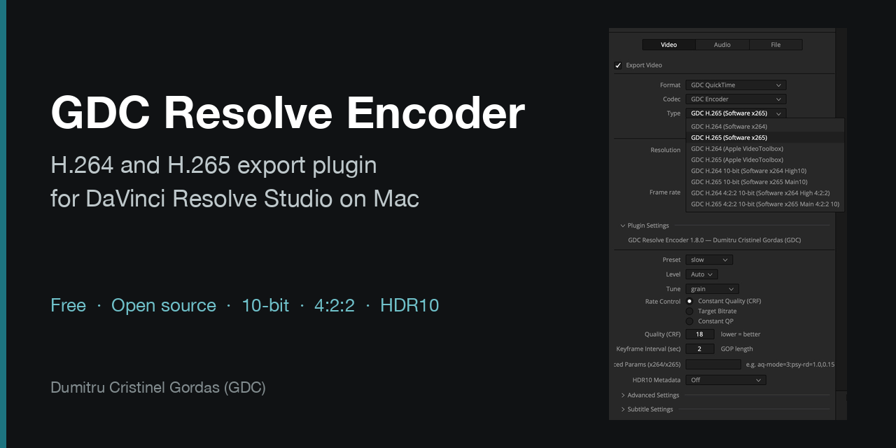

<p align="center"></p>

# GDC Resolve Encoder

[Română](README.md) · [English](README.en.md) · **Español** · [Página del producto](https://gordas.dev/gdc-resolve-encoder/es/)

Plugin **gratuito y de código abierto** para **DaVinci Resolve Studio** en Mac: añade a Deliver encoders H.264 y H.265 completos, 10 bits, 4:2:2, HDR10 y tres contenedores propios (GDC QuickTime, GDC MP4, GDC Matroska).

Sin cuenta, activación, periodo de prueba ni donación obligatoria: instalas y exportas.

## Descarga

Última versión: [Releases](https://github.com/gordasgdc/gdc-resolve-encoder/releases/latest) · paquete macOS `GDCResolveEncoder-<versión>.pkg` (firmado y notarizado, Apple Silicon, macOS 26+ declarado por el build, verificado en macOS 27). Funciona solo con DaVinci Resolve Studio; la versión gratuita de Resolve no carga plugins de exportación.

1. Abre el `.pkg` con doble clic y sigue el instalador (pide la contraseña de tu Mac).
2. Reinicia DaVinci Resolve.
3. En **Deliver**: **Format** → GDC QuickTime / GDC MP4 / GDC Matroska, **Codec** → GDC Encoder, **Type** → la variante deseada.

Guía PDF completa (RO · EN · ES): [`docs/guides/`](docs/guides/).

## Qué ofrece

| Variante de Type | Encoder | Profundidad / croma |
|---|---|---|
| GDC H.264 / H.265 (Software) | x264 / x265 | 8 bits 4:2:0 |
| GDC H.264 / H.265 (Apple VideoToolbox) | hardware | 8 bits 4:2:0 |
| GDC H.264 / H.265 10-bit | x264 High10 / x265 Main10 | 10 bits 4:2:0 |
| GDC H.264 / H.265 4:2:2 10-bit | x264 High 4:2:2 / x265 Main 4:2:2 10 | 10 bits 4:2:2 |

- Calidad constante (CRF), bitrate objetivo o QP constante; preset, tune, nivel, intervalo de fotogramas clave, parámetros avanzados de x264/x265.
- **HDR10**: mastering display y MaxCLL/MaxFALL, en el flujo de vídeo y en el contenedor (exportaciones PQ).
- Etiquetas de color escritas en el archivo; audio PCM sin cambios.
- Las variantes por hardware aparecen solo si tu Mac puede ejecutarlas.

## Verificado

Edición 1.8.0, DaVinci Resolve Studio 21.2, Mac con Apple Silicon, material de cámara de cine, 17 exportaciones (clips completos y una secuencia de varios clips, con sonido): PSNR mínimo de 40,6 dB frente al original, fotogramas contados correctamente, sonido sincronizado (desfase 0) e idéntico al original salvo los fundidos en los bordes de los clips, etiquetas de color y HDR10 presentes, reimportación sin errores. Los scripts de verificación están en [`tests/`](tests/).

## Windows

**Windows — edición gratuita v1.7.1 (mantenimiento), sin activación.** Parte de la última base estable de Windows (v1.7.0) sin el código de licencia: sin cuenta, periodo de prueba, código de activación, donación obligatoria ni llamadas a servidores; las funciones siguen siendo las de v1.7.0, sin funciones nuevas. El desarrollo para Windows está suspendido y se agradecen las contribuciones.

- **Estado real:** el código está en la rama `maintenance/windows-1.7.1` y el paquete se construirá en CI (FFmpeg 9.0.2 fijado). **Aún no se ha verificado la carga ni la exportación con imagen y sonido en DaVinci Resolve Studio en Windows**: ya no dispongo de un sistema Windows. La descarga gratuita aparecerá en [Releases](https://github.com/gordasgdc/gdc-resolve-encoder/releases) (como versión preliminar) y en la [página del producto](https://gordas.dev/gdc-resolve-encoder/es/) solo cuando el paquete esté construido y publicado. Quien pueda hacer la prueba en Windows ayuda directamente; consulta [CONTRIBUTING.md](CONTRIBUTING.md).
- Instalación (tras la publicación): descomprime, ejecuta `install.bat` (doble clic; pide por sí mismo permisos de administrador) y reinicia DaVinci Resolve Studio.
- La versión histórica v1.7.0 sigue en el archivo de releases, pero requiere un código de activación vinculado al Machine ID: no es la edición sin activación y no se ofrece como descarga.


## Compilar desde el código fuente (macOS)

```bash
brew install cmake pkg-config ffmpeg dylibbundler
cmake -B build -DCMAKE_BUILD_TYPE=Release -DCMAKE_OSX_ARCHITECTURES=arm64
cmake --build build -j
./bundle_ffmpeg_mac.sh <bundle> gdc_resolve_encoder.dvcp   # copia FFmpeg y sus dependencias al bundle
```

El `.pkg` se construye con `./build_installer.sh <versión>`. Pruebas que no necesitan Resolve: `cmake --build build --target pixconv_test mux_roundtrip` y después `tests/run_mux_tests.sh`.

## Contribuciones

Se aceptan Issues y Pull Requests, sobre todo para Windows; consulta [CONTRIBUTING.md](CONTRIBUTING.md). El proyecto tiene mantenimiento ocasional.

## Licencia

Código del plugin: MIT ([LICENSE](LICENSE)). El paquete para Mac incluye FFmpeg, x264 y x265 y se distribuye bajo **GPLv3**; los textos de licencia, la oferta de código fuente y la lista de bibliotecas están en [THIRD_PARTY_LICENSES.md](THIRD_PARTY_LICENSES.md) y [`legal/`](legal/), y dentro del paquete (`Contents/Resources/Licenses`). Construido sobre el DaVinci Resolve IO Encode Plugin SDK (Blackmagic Design), redistribuido según exige el SDK. Proyecto independiente: no está desarrollado, aprobado ni respaldado por Blackmagic Design.

## Autor

**Dumitru Cristinel Gordas (GDC)** · [GitHub](https://github.com/gordasgdc) · [YouTube](https://www.youtube.com/@cristigordas)
