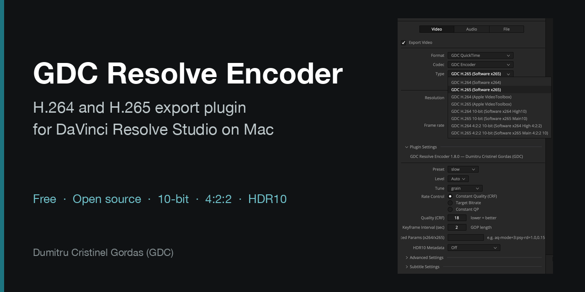

<p align="center"></p>

# GDC Resolve Encoder

**Română** · [English](README.en.md) · [Español](README.es.md) · [Pagina produsului](https://gordas.dev/gdc-resolve-encoder/)

Plugin **gratuit și cu sursă deschisă** pentru **DaVinci Resolve Studio** pe Mac: adaugă în Deliver encodere H.264 și H.265 complete, 10-bit, 4:2:2, HDR10 și trei containere proprii (GDC QuickTime, GDC MP4, GDC Matroska).

Fără cont, activare, perioadă de probă sau donație obligatorie: instalezi și exporți.

## Descărcare

Ultima versiune: [Releases](https://github.com/gordasgdc/gdc-resolve-encoder/releases/latest) · pachet macOS `GDCResolveEncoder-<versiune>.pkg` (semnat și notarizat, Apple Silicon, macOS 26+ declarat de build, verificat pe macOS 27). Funcționează numai cu DaVinci Resolve Studio; versiunea gratuită Resolve nu încarcă pluginuri de export.

1. Deschide pachetul `.pkg` cu dublu-clic și urmează pașii (cere parola Mac-ului).
2. Repornește DaVinci Resolve.
3. În **Deliver**: **Format** → GDC QuickTime / GDC MP4 / GDC Matroska, **Codec** → GDC Encoder, **Type** → varianta dorită.

Ghid PDF complet (RO · EN · ES): [`docs/guides/`](docs/guides/).

## Ce oferă

| Variantă din Type | Encoder | Adâncime / crominanță |
|---|---|---|
| GDC H.264 / H.265 (Software) | x264 / x265 | 8-bit 4:2:0 |
| GDC H.264 / H.265 (Apple VideoToolbox) | hardware | 8-bit 4:2:0 |
| GDC H.264 / H.265 10-bit | x264 High10 / x265 Main10 | 10-bit 4:2:0 |
| GDC H.264 / H.265 4:2:2 10-bit | x264 High 4:2:2 / x265 Main 4:2:2 10 | 10-bit 4:2:2 |

- Calitate constantă (CRF), bitrate țintă sau QP constant; preset, tune, level, keyframe interval, parametri avansați x264/x265.
- **HDR10**: mastering display și MaxCLL/MaxFALL, în fluxul video și în container (exporturi PQ).
- Etichete de culoare scrise în fișier; sunet PCM scris neschimbat.
- Variantele hardware apar doar dacă Mac-ul tău le poate rula.

## Verificat

Ediția 1.8.0, DaVinci Resolve Studio 21.2, Mac cu Apple Silicon, material de cameră de cinema, 17 exporturi (clipuri întregi și o secvență cu mai multe clipuri, cu sunet): PSNR minim 40,6 dB față de sursă, cadre numărate corect, sunet sincron (decalaj 0) și identic cu sursa în afara fade-urilor de la marginea clipurilor, etichete de culoare și HDR10 prezente, reimport fără erori. Scripturile de verificare sunt în [`tests/`](tests/).

## Windows

**Windows — ultima versiune stabilă publicată: [v1.7.0](https://github.com/gordasgdc/gdc-resolve-encoder/releases/tag/v1.7.0).** Dezvoltarea și testarea pentru Windows sunt suspendate deoarece nu mai am un sistem Windows disponibil pentru verificări. Versiunea existentă rămâne disponibilă pentru descărcare. Contribuțiile pentru continuarea suportului Windows sunt binevenite.

- Descărcare directă: [`gdc-resolve-encoder-windows-x64.zip`](https://github.com/gordasgdc/gdc-resolve-encoder/releases/download/v1.7.0/gdc-resolve-encoder-windows-x64.zip) (50,2 MB, SHA-256 `785d1dc93e3c8085c7ae29b0b6a405ffc4e1384cf6735e09163ed187ed44d5f2`). Linkul rămâne valid și după ce 1.8.0 devine „Latest”.
- Instalare: dezarhivează, apoi rulează `install.bat` (dublu-clic): copiază `gdc_resolve_encoder.dvcp.bundle` în `%ProgramData%\Blackmagic Design\DaVinci Resolve\Support\IOPlugins\`, cerând singur drepturi de administrator. Repornește DaVinci Resolve Studio. NVENC cere placă NVIDIA cu driver actual.
- **Condiții de utilizare (diferă de ediția gratuită macOS):** v1.7.0 necesită un cod de activare legat de Machine ID, iar susținerea proiectului se face exclusiv ca donație; termenii și ghidul din arhivă descriu acele condiții. Ediția macOS 1.8.0 nu cere activare, cont, perioadă de probă sau donație.


## Construire din sursă (macOS)

```bash
brew install cmake pkg-config ffmpeg dylibbundler
cmake -B build -DCMAKE_BUILD_TYPE=Release -DCMAKE_OSX_ARCHITECTURES=arm64
cmake --build build -j
./bundle_ffmpeg_mac.sh <bundle> gdc_resolve_encoder.dvcp   # copiază FFmpeg și dependențele în bundle
```

Pachetul `.pkg` se construiește cu `./build_installer.sh <versiune>`. Teste fără Resolve: `cmake --build build --target pixconv_test mux_roundtrip`, apoi `tests/run_mux_tests.sh`.

## Contribuții

Issues și Pull Requests sunt binevenite, mai ales pentru Windows; vezi [CONTRIBUTING.md](CONTRIBUTING.md). Proiectul are mentenanță ocazională.

## Licență

Codul pluginului: MIT ([LICENSE](LICENSE)). Pachetul pentru Mac include FFmpeg, x264 și x265 și se distribuie sub **GPLv3**; textele licențelor, oferta de cod sursă și lista bibliotecilor sunt în [THIRD_PARTY_LICENSES.md](THIRD_PARTY_LICENSES.md) și [`legal/`](legal/), și în pachet (`Contents/Resources/Licenses`). Construit pe DaVinci Resolve IO Encode Plugin SDK (Blackmagic Design), redistribuit conform cerințelor SDK-ului. Proiect independent: nu este dezvoltat, aprobat sau susținut de Blackmagic Design.

## Autor

**Dumitru Cristinel Gordas (GDC)** · [GitHub](https://github.com/gordasgdc) · [YouTube](https://www.youtube.com/@cristigordas)
